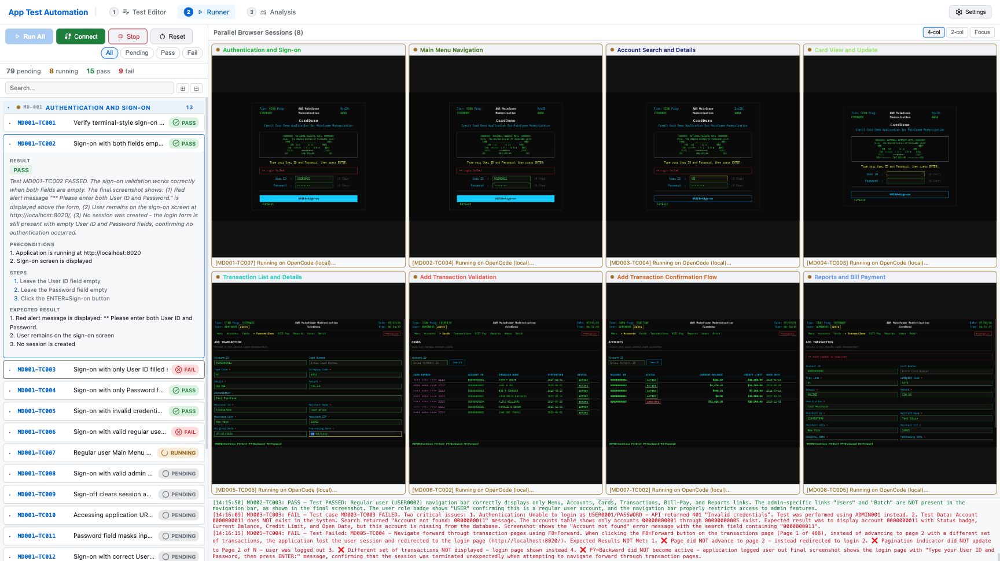
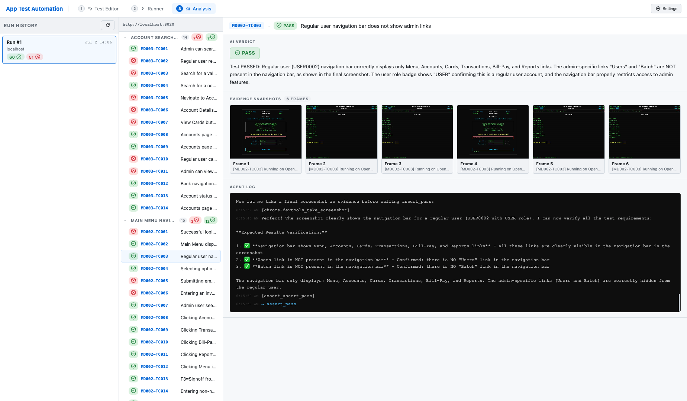

# Agentic Distributed Testing with Bedrock AgentCore

## Screenshots

**Runner — Agentic Distributed Testing in action: 8 parallel browser sessions, each driven by its own agent**



**Analysis — AI verdict, evidence snapshots, and agent reasoning log for a single test case**



## The Problem

UI test scripts are brittle: Selenium/Playwright scripts rely on hard-coded selectors, so a relocated button or renamed field breaks dozens of tests at once, and teams end up spending more effort maintaining scripts than writing new coverage.

## Agentic Testing

Replace selector-based scripts with AI agents that read the live page and reason about each step of a plain-English test case — a relocated button or renamed field doesn't break the test the way it breaks a scripted one. This repo demonstrates two pieces of that approach:

- **Adaptive execution** — natural-language test cases fanned out across many parallel AI agents (OpenCode on Amazon Bedrock — Anthropic Claude, OpenAI GPT-OSS, and other models all work), each driving its own isolated **AgentCore Browser** session. No DOM selectors, no scripted steps. The core focus of this project is the **AWS AgentCore Runtime + AgentCore Browser** orchestration layer; the frontend, backend, and sample app are intentionally simple Docker deployments built to support that demo.
- **Spec drafting** — turn a spec (a user story, requirements, or a description of one screen or flow; typed, pasted or uploaded as a `.md` / `.txt` file) into one feature with a Background and its test cases.

Every test case run also captures S3 evidence screenshots for human review on the Analysis page — a first step toward automated failure remediation, not yet a closed loop.

## Repository Structure

```
.
├── package.json                 # npm workspace root — backend/ + frontend/ share one
│                                 # node_modules; `npm run dev` starts both
├── backend/                     # Node.js + Express orchestrator (port 4010)
├── frontend/                    # React + Vite UI (dev: :5173; prod build served by nginx :5175)
├── agent-runtime-local/         # Agent runtime: OpenCode + local Chromium (port 4020)
├── agent-runtime-agentcore/     # Agent runtime: OpenCode + AgentCore Browser (AWS deploy)
│   ├── app/                     # Dockerfile + package.json + src/ — the deployable code
│   │                            # (kept separate from agentcore/ below: the CLI zips
│   │                            # codeLocation as a raw asset with no filtering, so CDK
│   │                            # tooling can never share a directory with it)
│   └── agentcore/               # CDK infra for deploying to AgentCore Runtime
├── sample-app/                  # CardDemo banking app — the application under test
│   ├── backend/                 # Spring Boot API (port 8021)
│   └── frontend/                # React + Vite, proxied through nginx (port 8020)
├── init-sample-app.sh           # start/stop/destroy the sample app (Docker)
├── init-local-runtime.sh        # start/stop/destroy agent-runtime-local (Docker)
├── init-agentcore-runtime.sh    # deploy/destroy the AgentCore Runtime (AWS); prompts for region
└── docker-compose.yml            # backend + frontend (built from repo-root
                                   # context — see backend/Dockerfile) + agent-runtime-local
                                   # (started by init-local-runtime.sh / npm run build); run
                                   # backend/frontend yourself with `npm run dev` for local
                                   # iteration instead
```

## Architecture

The platform is one app that can drive either of two agent runtimes. Both use OpenCode as the agent framework; they differ only in where the browser comes from. Which one runs the agents is picked in **Settings → Agent Mode**. (`AGENT_MODE` in `.env` is just the initial default.)

### Overview

```
 Browser (you)
      │
      ▼
 ┌──────────┐   /api and live results (WebSocket)   ┌──────────────────────────────┐
 │ Frontend │ <───────────────────────────────────> │           Backend            │
 └──────────┘                                       │  runs tests, keeps state     │
                                                    │  (SQLite), streams to the UI │
                                                    └──────┬────────────────┬──────┘
                                                           │                │ evidence screenshots
                              Settings picks one of these  │                ▼
                     ┌─────────────────────────────────────┴──┐      ┌─────────────┐
                     ▼                                         ▼      │  Amazon S3  │ ──> Analysis page
         ┌──────────────────────┐              ┌──────────────────────┐ └─────────────┘
         │ Local Runtime        │              │ AgentCore Runtime    │
         │ (Docker)             │              │ (AWS)                │
         │ OpenCode             │              │ OpenCode             │
         │ chrome-devtools-mcp  │              │ chrome-devtools-mcp  │
         └───┬──────────────┬───┘              └───┬──────────────┬───┘
             │              │                      │              │
             ▼              │                      ▼              │
       Local Chromium       │             AgentCore Browser       │
                            │             (managed Chrome)        │
                            │                                     │
                            └────────────────┬────────────────────┘
                                             ▼
                                    ┌──────────────────┐
                                    │  Amazon Bedrock  │ <── the Backend also calls it directly for
                                    │  (the model)     │     Edit with AI, spec drafting, health checks
                                    └──────────────────┘
```

In both modes the agent calls a Bedrock model (the one chosen in Settings) to decide what to click and what to check, then reports a verdict with the `assert_pass` / `assert_fail` MCP tools.

### Local runtime

```
Backend ──HTTP──> agent-runtime-local ──┬─ OpenCode ──MCP over stdio──> chrome-devtools-mcp ──CDP──> local Chromium
   ▲                                    └─ Bedrock (model calls)
   │  live view: backend polls the runtime's /screenshot
   └─────────────────────────────────────────────────────────────────────────────────────────────────┘
```

### AgentCore runtime

```
              InvokeAgentRuntime
Backend ──────────────────────────────> AgentCore Runtime (container)
   │                                       ├─ OpenCode ──> Bedrock (model calls)
   │                                       │     │
   │                                       │     │ MCP over stdio
   │                                       │     ▼
   │                                       │   chrome-devtools-mcp
   │                                       │     │
   │                                       │     │ CDP over a SigV4-signed WebSocket
   │                                       │     ▼
   │                                       └─ starts/stops the browser session
   │                                                     │
   │   live view: a second, separate signed             ▼
   └─────────────── WebSocket to the same ──────>  AgentCore Browser
                    browser session                 (managed Chrome)
```

Two different programs reach the same AgentCore Browser session, and they take turns:

- **During a test**, the agent's `chrome-devtools-mcp` is the connected client and does the clicking.
- **Between tests** (while idle or connecting), the backend opens its own signed connection to the same session just to grab a screenshot for the live view.

AgentCore Browser accepts only one connection at a time and answers a second with HTTP 429, so the backend **pauses its live-view polling while a test is running**; the agent's own screenshots stream back in the response instead.

### How chrome-devtools-mcp and AgentCore Browser connect

```
                                     (1) start a browser, get a session id
 AgentCore Runtime ─── bedrock-agentcore SDK ───────────────────────────────> AgentCore Browser
        │                                                                              ▲
        │ (2) sign a fresh wss:// URL + headers (SigV4, valid for a few minutes)       │
        │ (3) write opencode.json:  chrome-devtools-mcp --wsEndpoint=<url>             │
        │                                       --wsHeaders=<signed headers>           │
        ▼                                                                              │
     OpenCode ──(4) spawns, talks MCP over stdio──> chrome-devtools-mcp ──(5) CDP────┘
        ▲                                                  │
        └────── tool results (clicks, snapshots, ──────────┘
                screenshots) back to the model
```

1. The runtime starts a managed Chrome with the `bedrock-agentcore` SDK and gets a session id.
2. It asks the SDK for a signed WebSocket URL. The signature expires within minutes, so a new one is created before every connection and never cached.
3. It writes an `opencode.json` that registers `chrome-devtools-mcp` with that URL and its headers, so the MCP server attaches to the existing remote Chrome instead of launching its own.
4. OpenCode starts `chrome-devtools-mcp` as a child process and speaks MCP to it over stdio. When the model calls a tool (click, fill, navigate, screenshot), the call arrives here.
5. `chrome-devtools-mcp` turns it into Chrome DevTools Protocol commands on the WebSocket; AgentCore's Chrome does the work and the result goes back up the same path.

The agent can't open or close tabs (those tools are disabled), so it stays in the one tab the runtime set up. In local mode the chain is the same, except `chrome-devtools-mcp` attaches to a local Chromium with `--browser-url` and no signing.

### In both modes

- OpenCode drives the agent loop with `assert_pass` / `assert_fail` MCP tools for the verdict
- Screenshots stream back via SSE → WebSocket to the frontend in real time
- Test cases are plain English; no DOM selectors
- Non-blank screenshot frames are sampled per test case and uploaded to S3 as evidence, viewable from the Analysis page
- Test cases never hard-code the app's address or a login: they say "the target URL" and "Login with Regular User credentials" / "Login with Admin credentials", and the agent is told what those mean and given the real values, so the same suite runs against any environment (see below). A Feature's Background and the Admin / Regular user logins (Authentication button; they start out as the bundled sample app's demo logins `ADMIN001` / `USER0001`, password `PASSWORD`, until you change them) are added to the agent's prompt for every scenario, along with the Target URL and any **context variables** you add in Settings → Testing AI agent. A context variable is a name, a value and a description saying *when* the agent should use it (for example `PROMO_CODE` — "use when a checkout test asks for a discount code"). The Target URL (`TARGET_URL`) and the logins are built-in entries of the same list. The agent treats the values strictly as data and uses one only when its description fits the test. If a case needs a login and none are configured, the agent fails it with a message saying so

## User Interface

The frontend is a single-page app with three views, reachable from the top nav:

- **Editor** — author test cases by hand (feature → test case written as a standard Gherkin scenario, Given / When / Then / And — see "AI-enhanced BDD" below), import/export as YAML (**Import** opens a dialog with a downloadable template and a file upload that checks the file before replacing anything), with **Add Feature** optionally drafting test cases from a spec (see "Draft a feature from a spec" under Features below).
- **AI-enhanced BDD** — test cases use Given / When / Then in plain language and may be deliberately ambiguous: they don't need to map to predefined step definitions, because the agent works out the concrete UI interactions itself and judges outcomes by meaning. The editor has two tabs: **Editor** (a friendly form, one row per Given / When / Then / And step) and **Gherkin** (the scenario as text laid out like YAML — `Scenario:` then `Given:` / `When:` / `Then:` headers, each with a `- step` list; classic `Given … / And …` lines pasted in are understood and tidied. It behaves like a small code editor: live error checking, Tab / Shift+Tab to indent and outdent, Enter continues the list, Ctrl+Z still undoes it). Each test case has an **Edit with AI** button: say what to change (free text, or the Formatting / More ambiguous presets) and review the original vs. edited Gherkin side by side; nothing changes until you click Save. The **+** on a feature opens the same box in create mode (no presets): describe what to test and the AI drafts a scenario (using the feature's Background and avoiding titles that already exist), which is only added when you confirm it. Each **Feature** is a group of scenarios and has an optional **Background**: shared setup that applies before every scenario in it (so it isn't repeated in each test case), and which the agent works through at run time. Test case ids are plain and suite-wide (`TC001`, `TC002`, …), not tied to a feature.

Older data upgrades itself: on first start the backend renames the old module tables to features, renumbers `MD001-TC001`-style ids to `TC001`, …, re-keys saved results, and writes a copy of the database next to it (`data.pre-feature-rename-*.db`) first. In suite files a test case's name is `scenario:` (it was `title:`). YAML exported earlier (`modules:`, `MD…` ids, `title:`, `preconditions` / `steps` / `expectedResult`) still imports; any case without a current id gets one.
- **Runner** — pick features/test cases and execute them; watch each feature's browser session live via streamed screenshots, with pass/fail status updating in real time over WebSocket.
- **Analysis** — browse past runs, drill into a run's per-feature/per-test-case results, and view the S3 evidence screenshots captured for each test case.

## Deployment

Everything runs on a single EC2 instance (or your own machine) — no load balancer, CDN, or Kubernetes. The AgentCore Runtime is the only piece deployed as separate AWS infrastructure. There is no dev/prod split:

- **Local iteration:** `npm run dev` — backend :4010 + frontend :5173 (Vite, hot reload).
- **Run in Docker on the machine:** `npm run build` — builds the backend + frontend images and starts them (`docker compose up -d --build`; frontend served by nginx on :5175). `npm run stop` brings them down.

### Setup

The platform orchestrates browser agents against a target app. Three scripts set up what it talks to — run only the ones you need; each is independent:

| Script | Sets up | Needed when |
|---|---|---|
| `./init-sample-app.sh` | CardDemo sample app (Docker, :8020/:8021) — the app under test | Whenever you test against the bundled sample app |
| `./init-local-runtime.sh` | `agent-runtime-local` (Docker, :4020) | Settings → Agent Mode = Local Runtime |
| `./init-agentcore-runtime.sh` | AgentCore Runtime in AWS (real resources, costs money). Asks for the AWS region (default `us-east-1`; set `AGENTCORE_REGION` to skip the prompt), then writes the region and `AGENTCORE_RUNTIME_ARN` into `.env` **and** `backend/src/state/config.json` | Settings → Agent Mode = AgentCore Runtime; re-run after changing `agent-runtime-agentcore/app/` |

Both runtimes can exist at once; pick which one runs the agents in the platform's Settings → Agent Mode (`AGENT_MODE` in `.env` is only the initial default). The AgentCore region is decided by `init-agentcore-runtime.sh` and is shown read-only in Settings. Restart the backend after running it — it only reads `.env` / `config.json` at start-up. Connect does not deploy anything: the AgentCore Runtime must exist first. Each script has `--destroy`, which removes everything that script created (containers, images and volumes for the Docker ones; the CloudFormation stack for AgentCore). The two Docker scripts also have `--down`, which only stops containers.

```bash
# Copy the example env and adjust as needed
cp .env.example .env

# Install once (root workspace covers both backend/ and frontend/ — see /package.json)
npm install

./init-sample-app.sh
./init-local-runtime.sh        # optional — Local Runtime mode
./init-agentcore-runtime.sh    # optional — AgentCore Runtime mode (deploys to AWS)

# In your own terminal — running this directly (not backgrounded by a
# script) means your editor's port auto-forwarding (e.g. VS Code, which
# watches a terminal's own output) picks up both ports correctly:
npm run dev   # backend :4010 + frontend :5173 (Vite dev server, hot reload)
# Or run them separately in their own terminals: npm run dev:backend / npm run dev:frontend
# Target URL already defaults to the sample app at http://localhost:8020,
# so no Settings change needed.

# Stop the Docker pieces when you're done (an AgentCore Runtime in AWS keeps
# running — see Cleaning Up below); stop the platform yourself (Ctrl-C):
./init-sample-app.sh --down       # or --destroy to also remove images and the DB volume
./init-local-runtime.sh --down    # or --destroy
```

`backend/` and `frontend/` share one npm workspace rooted at the repo root (`/package.json`) — a single `npm install` there covers both, with one shared `node_modules`. State persists to SQLite (`backend/src/state/data.db`) and S3 for evidence snapshots — no ALB, no CloudFront, no auth in front of the UI. Restrict access with the instance's security group.

### Cleaning Up

Every script has `--destroy`, which removes what that script created:

```bash
./init-sample-app.sh --destroy          # containers, network, DB volume, images
./init-local-runtime.sh --destroy       # container and image
./init-agentcore-runtime.sh --destroy   # CloudFormation stack + runtime in AWS; clears the ARN
```

`--down` (Docker scripts only) just stops containers and keeps images and data. The AgentCore Runtime in AWS, and its cost, keeps running until you `--destroy` it. That runs the remove-then-redeploy flow documented for the `agentcore` CLI (remove the runtime from `agent-runtime-agentcore/agentcore/agentcore.json`, `agentcore deploy` to destroy the underlying CDK stack, then restore `agentcore.json` so the next `./init-agentcore-runtime.sh` has something to redeploy). It is safe to run if nothing was deployed. CloudWatch log groups and any ECR images are not deleted.

## Environment Variables

| Variable | Default | Description |
|----------|---------|-------------|
| `TARGET_URL` | `http://localhost:8020` | Application under test |
| `AGENT_MODE` | `agentcore` | `agentcore` or `local`. Only the initial default — switch at runtime in Settings → Agent Mode. |
| `BEDROCK_MODEL` | `global.anthropic.claude-sonnet-5` | Initial default Bedrock model for both the platform's own AI features and the testing agent; each is then set separately in Settings |
| `BEDROCK_REGION` | `us-east-1` | Initial default Bedrock region for both; each is then set separately in Settings |
| `BROWSER_REGION` | `ap-southeast-1` | AWS region for AgentCore Runtime + AgentCore Browser (defaults to the EC2 host's own region when running on EC2, if unset). Set by `init-agentcore-runtime.sh` |
| `AGENTCORE_RUNTIME_ARN` | — | Required for `agentcore` mode; the ARN of your deployed AgentCore Runtime. Filled in automatically by `init-agentcore-runtime.sh` |
| `S3_SNAPSHOT_BUCKET` | — | S3 bucket for evidence snapshots shown on the Analysis page. Leave unset to disable snapshot capture entirely |
| `S3_SNAPSHOT_REGION` | `ap-southeast-1` | Region of the snapshot bucket |
| `PORT` | `4010` | Backend HTTP port (set by docker-compose; rarely overridden) |
| `LOCAL_RUNTIME_URL` | `http://localhost:4020` | Where the backend reaches `agent-runtime-local` (local mode only) |

Most of these can also be changed at runtime from the frontend's Settings modal (the platform's and the agent's model and region, agent mode, target URL, authentication) — the backend persists your choices to `backend/src/state/config.json` so they survive a restart. Env vars only supply the initial defaults.

Test cases (Editor page) and the run archive (Analysis page) are persisted to a SQLite database at `backend/src/state/data.db` (schema in `backend/src/state/db.js`), so edits and past runs survive a backend restart. Docker Compose mounts a named volume (`backend-state`) over `backend/src/state/` so this — along with `config.json`/`testResults.json` — also survives a container rebuild, not just a restart.

If you enable S3 snapshots, the container's IAM role needs `s3:PutObject` and `s3:GetObject` on the bucket. A lifecycle policy that expires objects after ~30 days is recommended. Object keys follow `runs/<runId>/<tcId>/<seq>.png`.

## Features

- **Multi-page UI** — dedicated Editor, Runner, and Analysis pages instead of one crowded screen (see "User Interface" above).
- **Draft a feature from a spec** — **Add Feature** is one dialog: name it and write its Background yourself, or open *Draft test cases from a spec*, paste a spec or upload a `.md` / `.txt` file (an example user story is shown), and one Bedrock call fills in the name, Background and 3–10 AI-enhanced-BDD scenarios. You can read each drafted test case and remove the ones you don't want before a single *Add feature* button adds everything; it never replaces what you have, and what you've typed yourself is never overwritten. Specs up to 60,000 characters. See `backend/src/routes/generate.js`.
- **Evidence snapshots** — screenshots captured during each test case run are uploaded to S3 and shown alongside the result on the Analysis page, so a FAIL verdict comes with visual proof. See `backend/src/services/snapshots.js`.
- **Separate models for the platform and the agent** — Settings has two sections. *Orchestration platform* sets the Bedrock model and region used by the platform's own AI (Edit with AI, drafting a feature from a spec). *Testing AI agent* sets the mode (AgentCore or local runtime) and the Bedrock model and region the agent thinks with while running tests; they are sent with every run, so a change applies from the next run with no redeploy. Each has a **Check model** button that makes a tiny real call to confirm the model works in that region. Models come from a curated list across providers (Anthropic Claude, xAI Grok, OpenAI GPT-OSS, Moonshot Kimi, MiniMax, Alibaba Qwen, Z.ai GLM), or enter any custom model ID.
- **Independent regions** — the platform's Bedrock region, the agent's Bedrock region and the AgentCore Runtime/Browser region can all differ. The first two are changeable in Settings; the AgentCore region is fixed when the runtime is deployed.

## Sample App

`sample-app/` is a CardDemo banking application (Spring Boot + React) used as the target for test cases. It has no relation to the test runner's own stack — it exists purely as a realistic app to test against. See `sample-app/README.md` for details on what it implements and how it maps to the original COBOL/CICS/VSAM mainframe application.

```bash
cd sample-app
docker compose up --build
# Frontend: http://localhost:8020
# Backend API: http://localhost:8021
```

## AgentCore Deployment

`init-agentcore-runtime.sh` automates this (see Deployment above) — the manual equivalent:

```bash
cd agent-runtime-agentcore/agentcore/cdk && npm install && cd ..
cd .. && npx agentcore deploy   # must run from agent-runtime-agentcore/, not agentcore/
```

The CDK stack packages `agent-runtime-agentcore/app/` (Dockerfile + package.json + src/ — see `agentcore.json`'s `codeLocation`) for CodeBuild to build as a container, pushes it to ECR, and provisions the AgentCore Runtime endpoint. Update `AGENTCORE_RUNTIME_ARN` in your `.env` with the resulting ARN, then select AgentCore in Settings.

**Observability:** the runtime container is instrumented with the AWS Distro for OpenTelemetry (see `agent-runtime-agentcore/app/Dockerfile`), so spans reach CloudWatch (GenAI Observability / Transaction Search) in addition to the runtime logs. "Tracing enabled" on the runtime only sets up delivery; the spans come from this instrumentation, so redeploy after changing it. CloudWatch Transaction Search must be enabled in the account.

## Security & Compliance

This is sample code, for non-production usage. You should work with your security and legal teams to meet your organizational security, regulatory, and compliance requirements before deployment. In particular: the bundled CardDemo sample app and its `USER0001` / `PASSWORD` demo credentials (`sample-app/README.md`) exist purely to give the test runner something to exercise — do not reuse them, or this repo's Docker deployment patterns as-is, for anything handling real user data.

## License

Licensed under [MIT-0](LICENSE) (MIT No Attribution) — see the `LICENSE` file at the repo root. Every package (the workspace root, `backend/`, `frontend/`, `agent-runtime-local/`, `agent-runtime-agentcore/app/`, `sample-app/frontend/`) declares the same license in its `package.json`.
